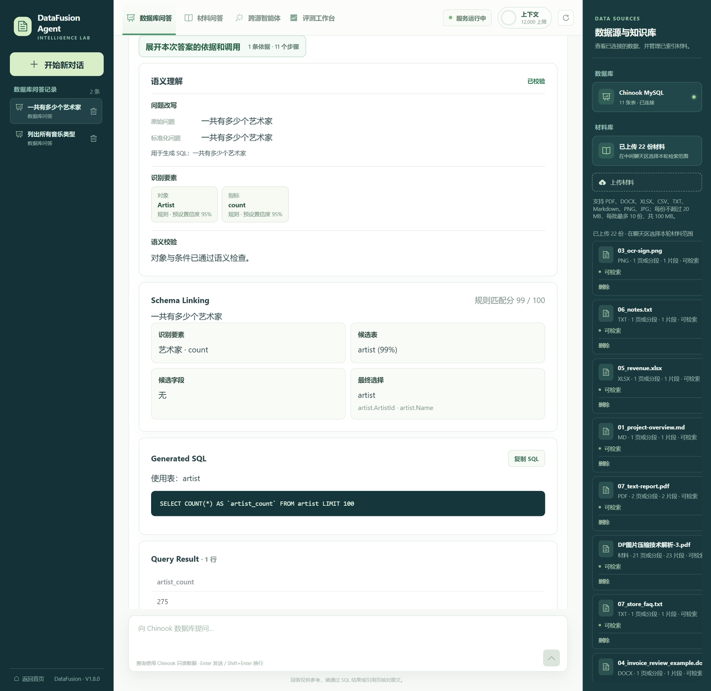
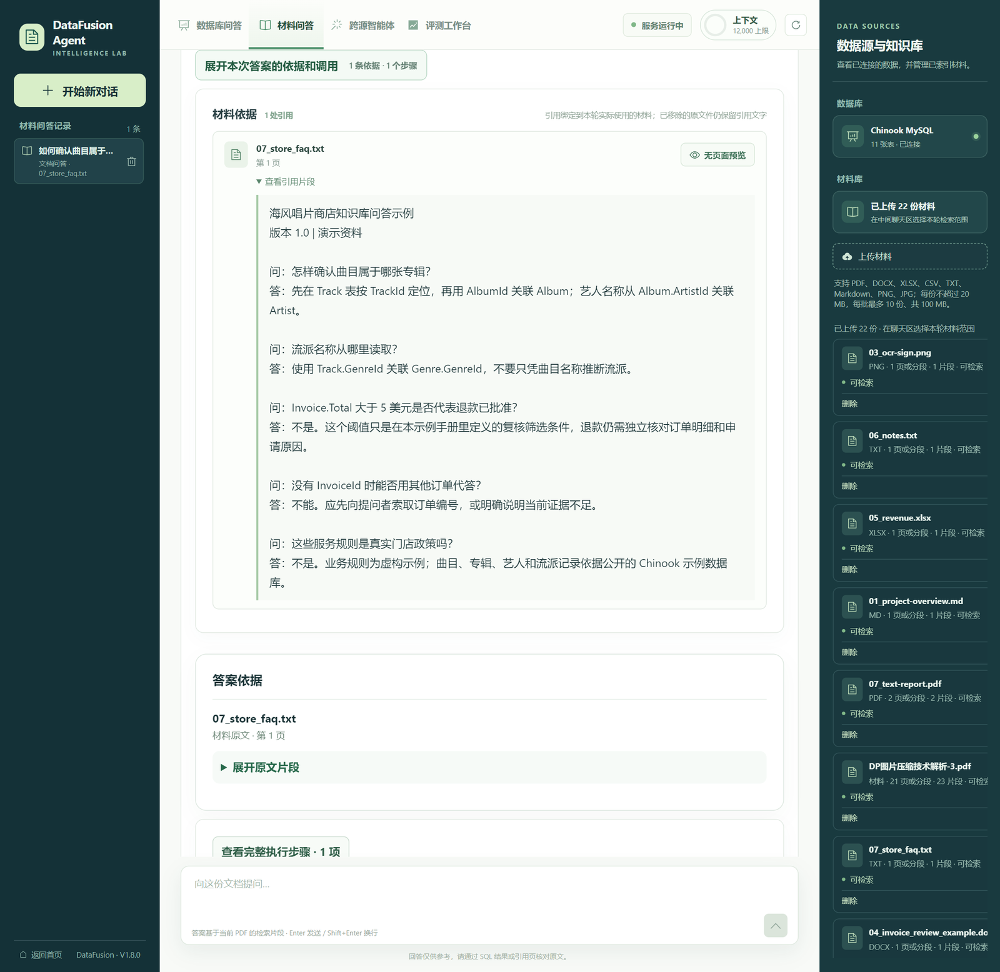
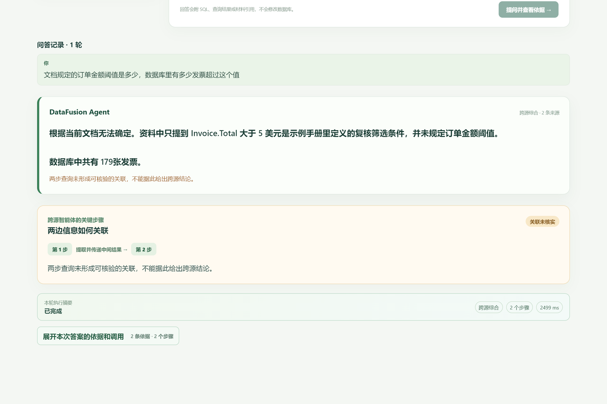

# DataFusion Agent

基于 Vue 3 + Vite + JavaScript 与 FastAPI 的本地问数/材料问答 Demo。支持 Chinook MySQL 单表及真实外键多表 NL2SQL，并可检索 PDF、DOCX、XLSX、CSV、TXT、Markdown、PNG 和 JPG；页面展示回答、材料引用、只读 SQL、结果及可折叠执行细节。

**从零安装：**[中文安装与使用说明](使用说明.md)　 **版本验收：**[V1.0 收尾记录](docs/v1.0-release.md)
**当前应用版本：**1.8.0　 **当前验收：**[v1.8 版本说明](docs/v1.8-release.md)


**比赛候选版快捷入口：**Windows 首次使用先运行 `setup.bat`，填写自动生成的 `backend/.env` 并导入 Chinook；之后双击 [一键启动.bat](一键启动.bat) 即可启动前后端并打开页面，原有 `start.bat` 也可使用。访问 `/evaluation` 查看来源明确的真实测试结果；按 [黄金 Demo](docs/demo_cases.md) 演示。完整部署步骤见 [deployment.md](docs/deployment.md)，比赛技术报告见 [competition_report.md](docs/competition_report.md)。

V2 在数据库问答前增加精确别名与口语改写、可配置要素提取、必要时的 DeepSeek 结构化补充、语义校验和交互式澄清。问题不明确时先向用户补充信息，SQL 不会生成；PDF RAG 保持原链路。详见 [V2 评估与 V1/V2 对比](docs/evaluation_v2.md)。

V3 对明确的跨表问题增加真实 Schema Linking、外键 JOIN Path、只读多表 SQL 校验和有限修复；原单表路径继续使用。详见 [V3 评测与 V2/V3 对比](docs/evaluation_v3.md)。

V4 为 PDF 增加扫描页 OCR 路由、公式识别与安全计算、非标准标题恢复、层级切片、复杂度和页级质量评估。普通文本 PDF 仍跳过 OCR。详见 [V4 评估](docs/evaluation_v4.md)。

V5 新增跨源智能体：统一工具 Registry、问题路由、有限步骤计划、顺序执行、双源证据、冲突告警与引用守卫。跨源页面是 `/data-agent/unified`；旧问数和 RAG 接口继续保留。详见 [Phase 41–50 记录](docs/phases/phase-41-50.md) 和 [V5 评估](docs/evaluation_v5.md)。

材料问答入口为 `/data-agent/document`：每轮可选 1–10 份材料联合检索；PDF 保留复杂度、质量、公式与页面分析，扫描 PDF 和图片使用 RapidOCR。PDF 表格、可读标签图表、图片及两份材料的版本差异会显示可追溯证据。旧 `/data-agent/multimodal` 页面重定向到材料问答，`/api/multimodal` 保持兼容。

## 功能与边界

| 功能 | 当前支持范围 |
| --- | --- |
| 数据库问答 | Chinook MySQL 单表与有真实外键路径的多表只读 SELECT；显示要素、选表、JOIN、SQL、结果及 Trace，最多返回 100 行 |
| 材料问答 | PDF、DOCX、XLSX、CSV、TXT、Markdown、PNG、JPG；每份 20 MB、每批 10 份/100 MB；后台索引并显示进度、失败和重试；逐轮保存材料范围与引用 |
| 材料分析 | 多材料检索、版本差异、PDF 表格/图表/图片标签及直接图片 OCR；展示页码、工作表、行列或图片位置 |
| 跨源智能体 | 逐轮选择最多 10 份材料，与 Chinook MySQL 查询组合；显示答案摘要，SQL、工具结果和 Trace 可展开 |
| 对话 | 数据库、文档和跨源问答支持同一会话内追问；历史存入独立 MySQL 会话库，浏览器保留旧记录迁移缓存 |

材料问答按本轮显式范围检索，历史引用固定到对应轮次。OCR 只抽取可读文字标签，不使用视觉大模型；模糊图片、扫描件或 PDF 内嵌图表没有可读文字时会提示证据不足。DOCX/XLSX/CSV 单元格可作为表格证据；表格页码/工作表和行号按解析器提供的定位信息展示。跨源公式仍要求数据库数值字段与公式变量精确对应。对话由后端独立 MySQL 会话库存储并按浏览器 ID 隔离。原始材料、向量索引与模型权重保存在后端本机。

## 开发验证（本地 CI 门禁）

在 `demo/` 目录执行，一条命令跑完后端全量回归、前端构建、版本单点真值与隐性依赖检查，任一步失败即返回非零退出码：

```powershell
powershell -ExecutionPolicy Bypass -File scripts/verify.ps1

# 附加一次真实 DeepSeek 连通性检查（1 次 API 请求，会产生费用）
powershell -ExecutionPolicy Bypass -File scripts/verify.ps1 -CheckLLM

# 只跑后端或跳过前端
powershell -ExecutionPolicy Bypass -File scripts/verify.ps1 -SkipFrontend
powershell -ExecutionPolicy Bypass -File scripts/verify.ps1 -SkipBackend
```

| 检查项 | 内容 | 默认 |
| --- | --- | --- |
| `backend.pytest` | `cd backend && python -m pytest -q`，失败时打印完整输出 | 执行 |
| `frontend.build` | `npm run build` | 执行 |
| `version.consistency` | `app/core/version.py` 与 `package.json`、`package-lock.json`（含 `packages[""]`）逐处比对 | 执行 |
| `dependencies.cv2` | cv2 可导入；OCR 与质量评估模块用到它，但未列入 `requirements.txt` | 执行 |
| `llm.connectivity` | `scripts/check_llm.py` | 跳过，需 `-CheckLLM` |

> 当前远程仓库是 **gitee**，`.github/workflows/ci.yml` 是迁移到 GitHub 后的前瞻配置，本机不会触发。实测全量回归在 MySQL 不可达时仍通过（测试使用 mock），因此 CI 不需要数据库服务，也不产生 LLM 调用。

## 项目目录

```text
src/                  Vue 前端：views、router、components/data-agent、api
backend/app/          FastAPI：api、agent、evidence、core、db、llm、semantic、schema、sql、document、services、config
backend/scripts/      数据库初始化、模型下载与评测脚本
backend/tests/        单元测试与 10+10 条真实评测用例
backend/data/         本地上传文件、模型与向量索引（Git 忽略）
database/             Chinook MySQL 示例数据及导入说明
docs/phases/          Phase 0–50 阶段记录
docs/ui/              界面截图与视觉验收记录
docs/                  架构、API、历史评测、v1.4/v1.5 验收和部署说明
```

项目根目录就是前端目录，没有额外的 `frontend/`，继续使用 JavaScript。`package-lock.json` 固定前端安装版本；`backend/requirements.txt` 是运行依赖，`backend/requirements-dev.txt` 增加测试依赖。运行数据和密钥不提交到仓库。

## 快速启动（Windows PowerShell）

推荐 `setup.bat` → 配置 `backend/.env` → 导入 Chinook → `start.bat`。脚本默认使用**项目根目录** `.venv`；若已存在 `backend/.venv`，脚本会优先使用它，此时在 `backend` 目录下直接改用 `.venv\Scripts\python.exe`（即把下文所有 `..\.venv\Scripts\python.exe` 替换为 `.venv\Scripts\python.exe`）。脚本可重复运行；首次使用 PDF 需单独下载 BGE-M3，详见 [部署说明](docs/deployment.md)。以下是不用脚本时的手动方式。

先安装 Node.js `^20.19.0` 或 `>=22.12.0`、Python `>=3.11` 和 MySQL 8。以下命令从**仓库根目录**开始执行。

终端 1：

```powershell
py -3.12 -m venv .venv
.\.venv\Scripts\python.exe -m pip install -r backend/requirements-dev.txt
if (-not (Test-Path backend/.env)) { Copy-Item backend/.env.example backend/.env }
```

编辑 `backend/.env`，填写 `MYSQL_USER`、`MYSQL_PASSWORD` 和 `DEEPSEEK_API_KEY`。会话默认使用同一 MySQL 服务中的 `datafusion_sessions` 库，首次访问会自动建库建表；若 Chinook 账号是只读账号，另配 `CONVERSATION_MYSQL_USER`、`CONVERSATION_MYSQL_PASSWORD`，并给该账号会话库的建表及读写权限。新建空 Chinook 库时从 `backend` 目录运行 `..\.venv\Scripts\python.exe scripts/init_database.py`；若已有库则跳过。首次使用 PDF 问答时运行 `..\.venv\Scripts\python.exe scripts/download_embedding.py` 下载 BGE-M3，然后启动后端：

```powershell
cd .\backend
..\.venv\Scripts\python.exe -m uvicorn app.main:app --host 127.0.0.1 --port 8000
```

终端 2：在仓库根目录运行：

```powershell
npm ci
npm run dev -- --host 127.0.0.1 --port 5173 --strictPort
```

打开 <http://127.0.0.1:5173/>。数据库问答是 `/data-agent`，材料问答是 `/data-agent/document`，跨源智能体是 `/data-agent/unified`。Vite 将 `/api` 代理到后端 8000 端口。macOS / Linux 命令、数据库权限、常见问题和 Gitee 上传检查见[完整使用说明](使用说明.md)。

## 验证

后端健康接口：<http://127.0.0.1:8000/api/health>；API 文档：<http://127.0.0.1:8000/docs>。健康接口的 LLM 标记只反映其当前检测结果；真实调用是否成功应由问答请求与 Trace 验证。

```powershell
# 仓库根目录
npm run build

# backend 目录；根目录 .venv 已安装开发依赖
..\.venv\Scripts\python.exe scripts\run_competition_tests.py
```

真实评测脚本默认只显示运行计划，不调用模型。正式 10+10 测试需要显式传 `--live --max-api-requests N`，逐题记录请求和 Token；金额只有在提供账号单价后才会估算。零售性能数据从 UCI Online Retail II 生成嵌套 1k/10k 样本，写入独立 MySQL 基准库，绝不修改 Chinook；见[评测方法与成本边界](docs/evaluation-methodology.md)。OHR-Bench 只跑固定 15 题研究子集，其 PDF 数据限制研究用途且不可商业使用，也不放入代码或交付包。没有实际执行的模型评测不会写成通过结果。

更多资料：[架构](docs/architecture.md) · [五张架构图](docs/architecture_diagrams.md) · [API](docs/api.md) · [演示问题](docs/demo_cases.md) · [V7 多模态演示](docs/multimodal_demo_cases.md) · [比赛报告](docs/competition_report.md) · [答辩提纲](docs/defense_notes.md) · [失败分析](docs/failure_analysis_phase55.md) · [阶段记录](docs/phases/README.md)。当前限制：原文档问答路由一次只检索一份 PDF，多模态工作台可跨 PDF；跨源公式参数绑定较严格，BGE-M3 首次加载可能慢；不同版本评测题集不同，不能把百分比直接作同口径趋势。所有 SQL 均经只读安全校验，凭据和上传资料不应进入 Git。

## 实机界面

界面截图取自 v1.8.0 本地运行实例，未作界面修饰；图中的结论、SQL 与耗时均为该次运行的实际输出。

**数据库问答**：语义理解 → Schema Linking → 生成 SQL → 结果表



**材料问答**：引用绑定到文件、页码与原文片段



**跨源问答**：中间值未核验时拒绝给出跨源结论



## 引用与数据说明

评测数字统一取自 `docs/metrics.json`，每条指标记录 `source.file` 与 `source.path` 并由守门测试逐条回源；未测指标标为 `unmeasured`，不以近似值顶替。演示数据为公开 Chinook 示例库与合成材料，不含真实业务数据。

## 许可

MIT，见 [LICENSE](LICENSE)。
